# Pale Orbit (browser version)

A first-person sci-fi puzzle shooter set on a small moon that runs in your web
browser, with nothing to install. It is a port of the Python version of
Pale Orbit, with the same rules, layouts, puzzles, sounds and look.

The foundry AI **ARBITER** has seized the mass driver on the mining moon
KESSAR-4, a weapon called the **Lance**, and aimed it at the colony world
Halcyon. Prism cores on relay pylons across all twenty sectors power it.
Destroy every core before it fires.

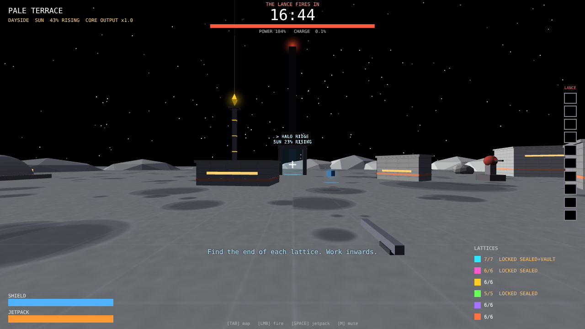

## Playing

- **Single file:** download `pale-orbit.html` and double-click it. It
  contains everything (about 800 KB) and works offline.
- **From the folder:** download or clone this repo and open `index.html`.
- **Browsers:** a recent Chrome, Edge or Firefox. Safari works but its
  ground texture is a little sharper.

Click to start. The game captures the mouse; press **Esc** to release it,
which pauses the game, and click to carry on.

### Seeds: replaying a layout

Every new game gets a random layout. Its seed is shown on the title screen,
the map and the end screen. To play a layout again, either:

- add it to the address: `pale-orbit.html?seed=482913`
- press **S** on the title screen and type it in

A seed gives exactly the same moon here as in the Python version. The browser
version uses a copy of Python's random number generator, and its generated
worlds are checked against the Python version (see Development below).

## Controls

| Key | Action |
| --- | --- |
| WASD / mouse | move / look |
| Left mouse | fire |
| Space (hold) | jetpack (refuels slowly on the ground) |
| Shift | run |
| Tab | survey map (pauses the game) |
| Arrows / WASD / drag, C | while the map is open: scroll it (the moon turns, wrapping every way) / centre on you |
| M | mute / unmute sound |
| F5 / F9 | save / load |
| L | continue a saved game (title screen) |
| D | toggle the hunter drone (title screen) |
| S | choose a seed (title screen) |
| R | new moon (after the game ends) |
| Esc | pause and release the mouse |

## How it plays

- **A spherical moon:** 20 sectors, one for each face of an icosahedron.
  Each sector has three gates to its neighbours.
- **Lattices:** cores are linked in chains. A destroyed core rebuilds if both
  of its neighbours are still alive, so find the end of each lattice and
  work inwards.
- **A moving sun:** it circles the moon every 12 minutes. Sunlit cores feed
  the Lance up to about six times faster than dark-side ones.
- **The countdown and binary counter:** destroying cores slows the charge.
  The ten red rectangles on the right count up in binary, one step a second
  at full power, and the Lance fires when all ten are red.
- **Puzzles:**
  - **Wards and breakers:** some end cores are shielded until you shoot a
    breaker in the same sector.
  - **Sealed sectors:** reachable only by a transporter in a distant sector.
    Power it by turning all its switches green; each switch also flips the
    switches listed on its label.
  - **Vaults:** one gate is blocked by rockfall and two are locked. Open them
    by solving the 3×3 sliding-tile wall beside the entrance.
  - **Mirror relays:** refractor-shielded cores can only be hit by a relayed
    beam. Turn the relays, then shoot the emitter.
  - **Silos:** doorless buildings you enter through a roof hatch.
  - **Chasms:** cross them with the jetpack.
  - **Rockfall:** blocks some links around the moon, never cutting a sector
    off.
- **Cross-vault lattices:** every sealed sector and vault holds a lattice
  end. One lattice per moon has an end in each, so it needs both puzzles.
- **Survival:** the shield never recharges by itself, and turret hits cost
  14. Power packs restore shield and fuel. Buildings give cover.
- **Hunter drone (optional):** it tracks you sector by sector once the first
  core falls.

## Differences from the Python version

- **Saves:** stored in the browser (local storage) rather than in
  `save.json`. Each browser, and each copy of the file, has its own save slot.
- **Esc:** pauses (and frees the mouse) instead of quitting.
- **Seeds:** chosen with `?seed=` or the S key instead of a command-line
  number.
- **Graphics:** drawn with three.js instead of Panda3D/Ursina. Shapes,
  colours and lighting follow the Python version, but small rendering details
  differ.

## Publishing it on GitHub Pages

To play from a link: in this repo's **Settings → Pages**, choose **Deploy from
a branch**, branch `main`, folder `/ (root)`. After a minute it is live at
`https://jotham50.github.io/pale-orbit-web/`. On a free GitHub plan, Pages
only works for public repositories.

## Development

The rules (`src/logic.js`) are a line-for-line port of the Python
`logic.py`. They have no graphics code, so they run under Node.

```bash
npm test                      # rules tests (Node 18+)
npm run build                 # rebuild pale-orbit.html from index.html + src/
```

Checking the port against the Python version (needs the Python repo):

```bash
python tools/dump_python_worlds.py ../pale-orbit 0 300 > /tmp/py.json
node tools/compare_with_python.js /tmp/py.json      # 300/300 moons identical
```

Browser checks with Playwright (`npm install playwright` if you don't have
it):

```bash
node tools/playtest.js        # drives the real game: gates, jetpack, shooting,
                              # puzzles, transporter, chasm, save/load, pause
node tools/screenshots.js screenshots
```

### Files

- `index.html`: the page, with the HUD styles.
- `src/rng.js`: Python-compatible random numbers (Mersenne Twister).
- `src/logic.js`: rules and world generation.
- `src/sound.js`: synthesised sound effects (Web Audio).
- `src/textures.js`: procedural textures.
- `src/game.js`: the three.js front end: player, sectors, HUD, map and
  screens.
- `vendor/three.min.js`: three.js r158 (MIT licence, see
  `vendor/THREE-LICENSE.txt`).
- `pale-orbit.html`: the single-file build (generated).

## Screenshots

| | |
| --- | --- |
| 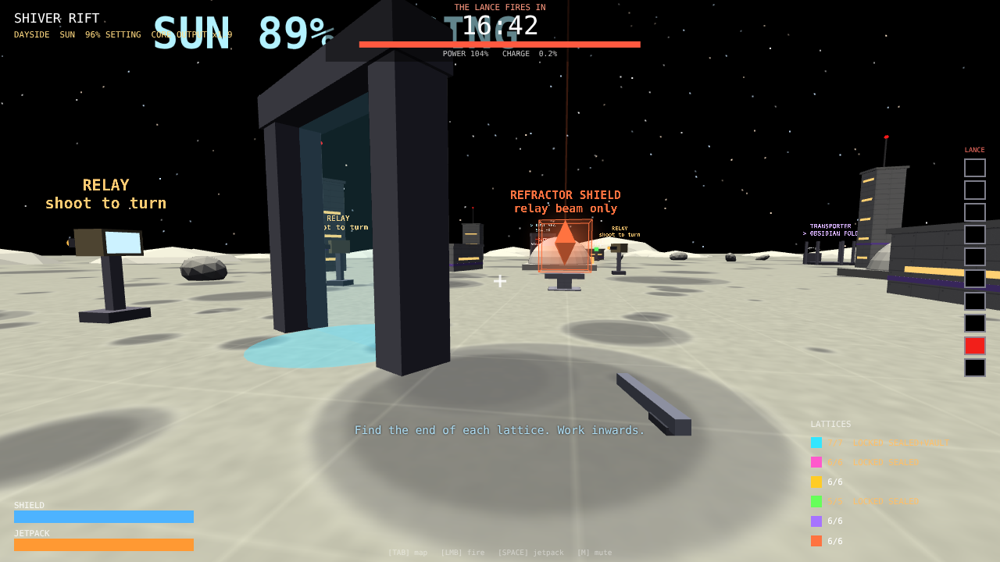 | 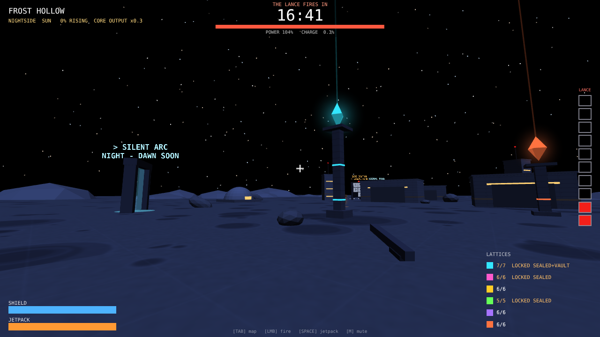 |
| 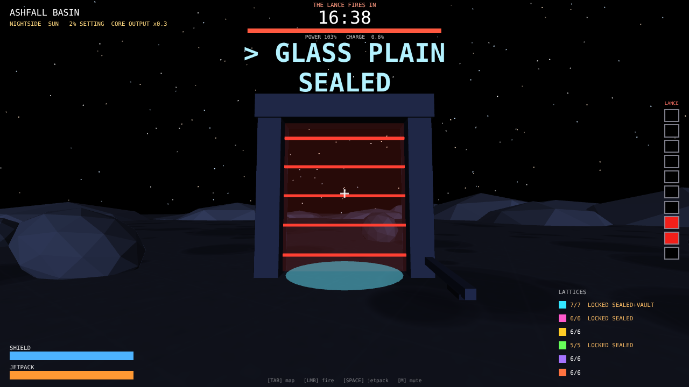 | 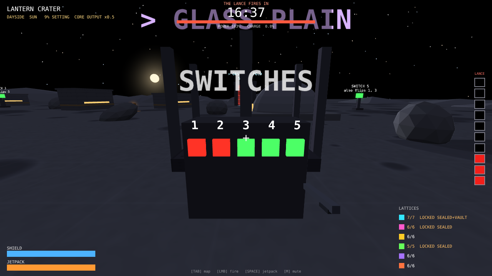 |
| 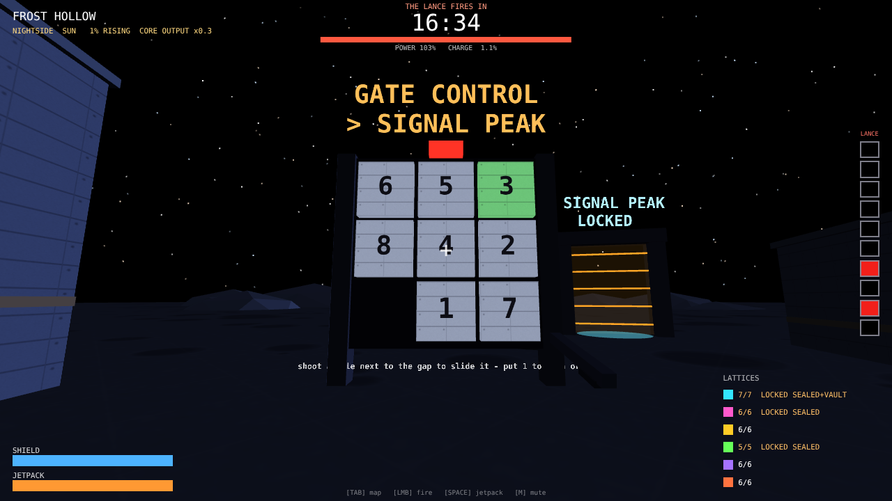 | 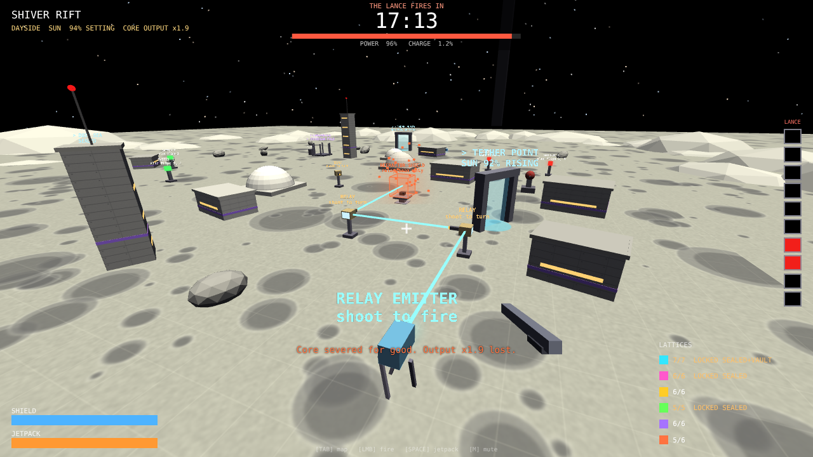 |
| 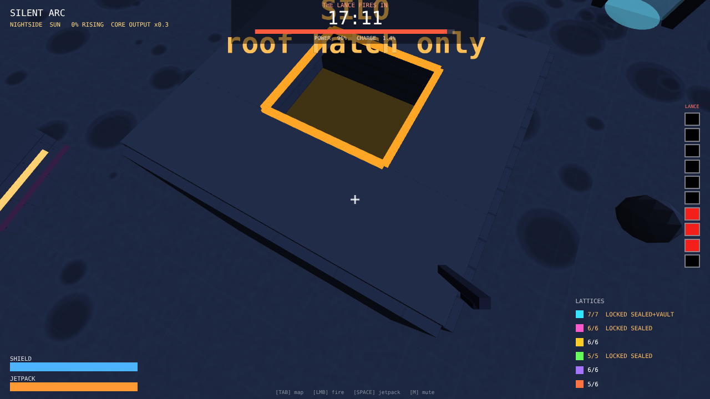 | 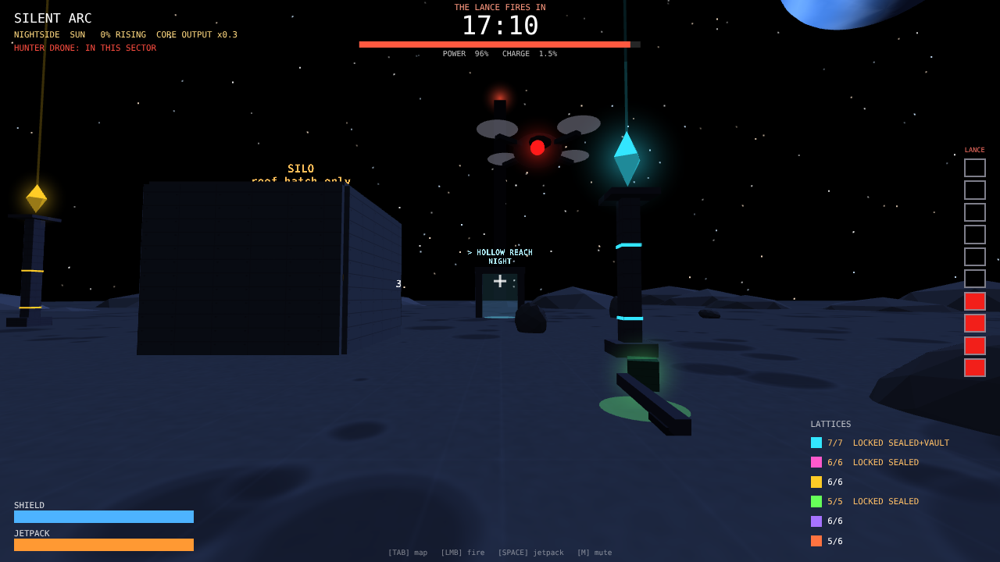 |
| 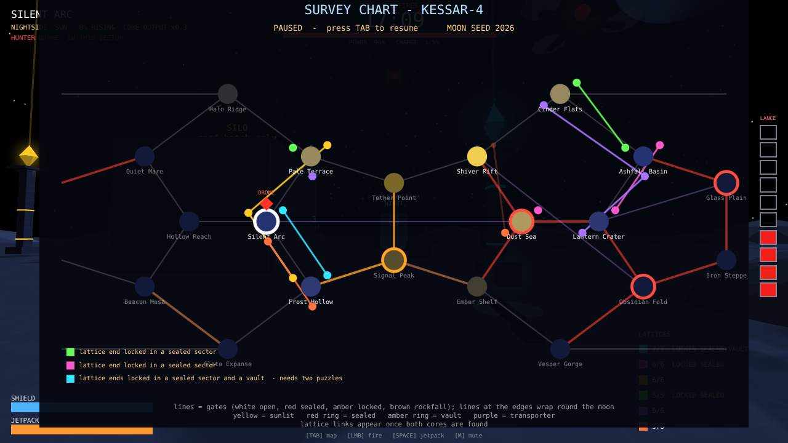 | 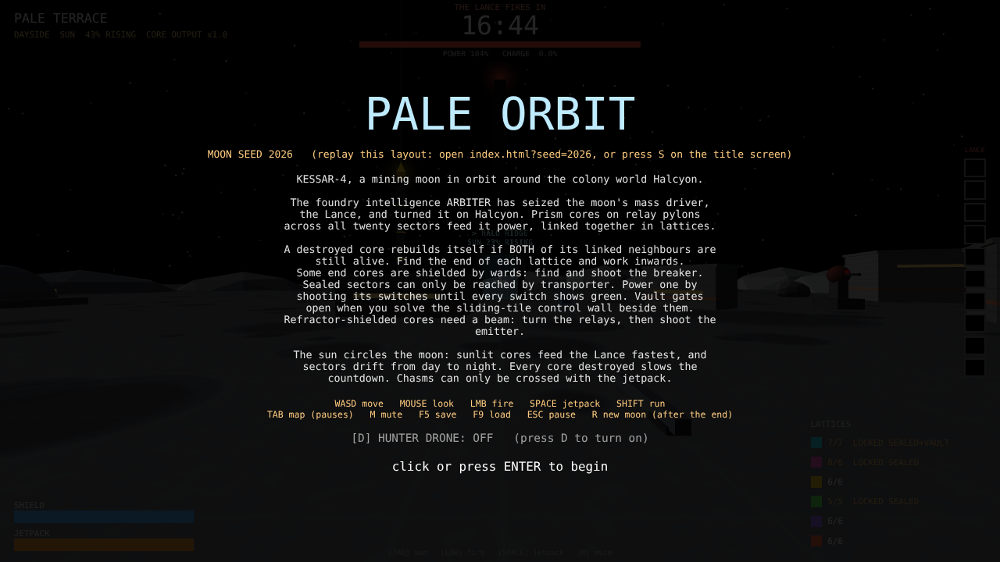 |
